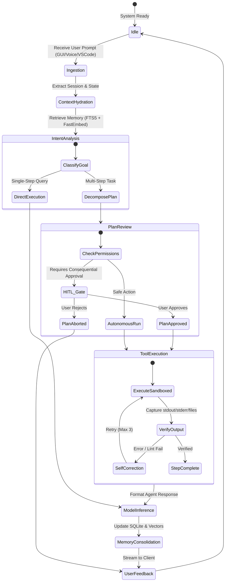
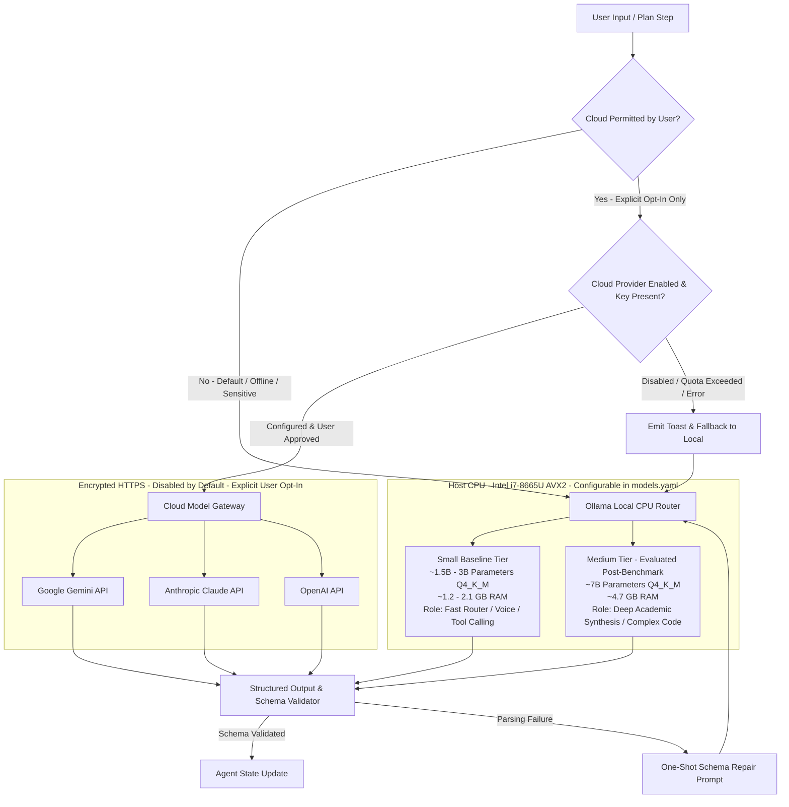
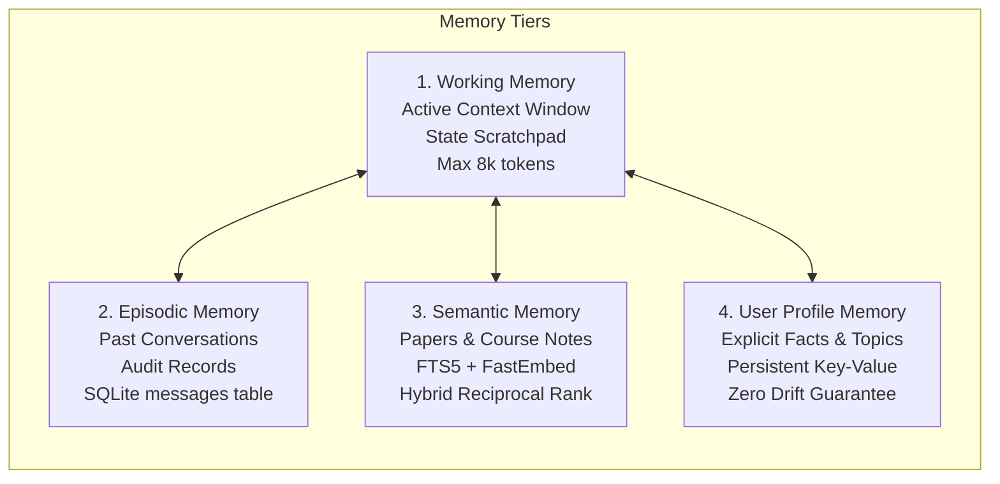
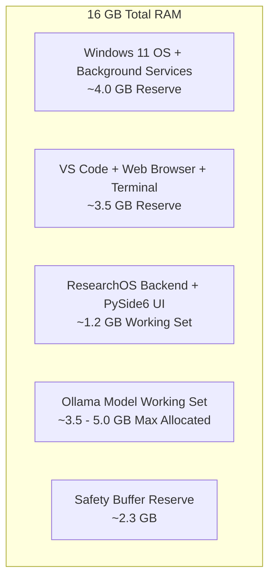
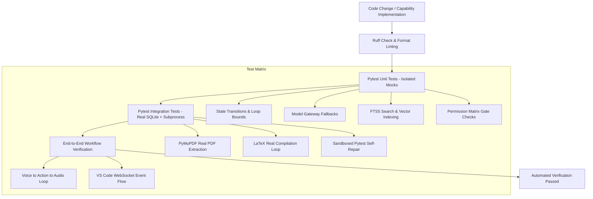

# ResearchOS AI — Master Technical Specification (v2.0)
**System Architecture, Engineering Specification & Phase-by-Phase Implementation Blueprint**

---

## Document Control & Metadata
- **Product Name**: ResearchOS AI
- **Codename**: JARVIS-Academic
- **Specification Version**: 2.1.0 (Production-Readiness Reviewed)
- **Target OS**: Windows 11 Pro (with Ubuntu WSL2 co-runtime)
- **Target Hardware Architecture**: Intel Core i7-8665U (4C/8T, AVX2, Whiskey Lake, 15W TDP), 16 GB DDR4 RAM, AMD Radeon Pro WX3200 4GB (DirectX/Vulkan display only, CPU-first inference)
- **Host Storage Allocations**: Workspace on `D:\Projects\ResearchOS-AI` (~169 GB free, bus unverified); C:\ partition protected (~16 GB free, zero weights/caches permitted)
- **Primary Languages**: Python 3.12 (Core, Backend, GUI, Voice), TypeScript / Node.js 20+ (VS Code Native Extension)
- **Document Status**: PRODUCTION-READINESS AUDITED & APPROVED FOR PHASED IMPLEMENTATION
- **Author**: Lead Systems Architect & ResearchOS AI Engineering Core

---

# 1. Executive Summary & Product Vision

### 1.1 The Vision: ONE Unified Autonomous Agent
ResearchOS AI is **NOT** a collection of fragmented chatbots, disjoint sub-agents, or isolated specialist assistants. It is **ONE unified, JARVIS-style personal AI agent** maintaining a continuous persona, persistent inspectable memory, and global situational awareness across the user’s academic, professional, and personal workflow.

Whether the user asks a quick question via a whisper hotkey, reviews an IEEE LaTeX paper in the PySide6 desktop GUI, analyzes a PyTorch baseline in WSL2, or triggers a refactoring refactor inside VS Code, **the identical agent brain, memory, permission matrix, and conversation lineage handle the request**.

```
                           +--------------------------------------------------+
                           |               USER INTERFACES                    |
                           |  - PySide6 Desktop GUI                           |
                           |  - Low-Latency Voice Hotkey (Whisper/Piper)      |
                           |  - Native VS Code IDE Extension                  |
                           |  - Interactive Windows CLI / Terminal            |
                           +------------------------+-------------------------+
                                                    | (FastAPI / WebSocket IPC)
                                                    v
+-------------------------------------------------------------------------------------------------------+
|                                    RESEARCHOS AI CORE AGENT ENGINE                                    |
|                                                                                                       |
|  +-------------------------------------------------------------------------------------------------+  |
|  |                                  SINGLE CENTRAL AI ORCHESTRATOR                                 |  |
|  |  * Deterministic StateGraph Planner        * Working Memory & Multi-Step Scratchpad             |  |
|  |  * Unified Persona & Context Routing       * Goal Decomposition & Auto-Verification             |  |
|  +------------------------------------------------+------------------------------------------------+  |
|                                                   |                                                   |
|             +-------------------------------------+-------------------------------------+             |
|             v                                     v                                     v             |
|  +-----------------------+             +-----------------------+             +-----------------------+  |
|  |     MODEL GATEWAY     |             |  INSPECTABLE MEMORY   |             |   SECURITY & HITL     |  |
|  | * Configurable Router |             | * SQLite WAL + FTS5   |             | * Explicit Approval   |  |
|  | * Ollama CPU-First    |             | * Sync Triggers (FK)  |             | * Restricted Sandbox  |  |
|  | * Cloud Opt-In Only   |             | * FastEmbed (CPU Vec) |             | * No Raw Shell Exec   |  |
|  | * Strict Pydantic     |             | * Episodic / Semantic |             | * Path Jailing & Kill |  |
|  +-----------------------+             +-----------------------+             +-----------------------+  |
|                                                   |                                                   |
|  +------------------------------------------------v------------------------------------------------+  |
|  |                              UNIFIED CAPABILITY & TOOL REGISTRY                                 |  |
|  |                                                                                                 |  |
|  |  [01] Personal Daily Assistance & Automation    [06] AI/ML Experimentation & Data Analysis      |  |
|  |  [02] University Study & Socratic Tutoring      [07] Academic Writing, LaTeX & BibTeX Engine    |  |
|  |  [03] Literature Review & Semantic Search      [08] Project Management & Proactive Reminders   |  |
|  |  [04] Research Idea & Gap Discovery             [09] Voice Assistant (Faster-Whisper + Piper)   |  |
|  |  [05] Python Programming & Code Automation      [10] VS Code Deep Editor Integration            |  |
|  +-------------------------------------------------------------------------------------------------+  |
+-------------------------------------------------------------------------------------------------------+
```

### 1.2 Ten Unified Capabilities
The single agent possesses ten integrated capabilities, dynamically orchestrated through tool routing without context fragmentation:
1. **Personal Daily Assistance & Automation**: Calendar awareness, daily briefings, automated file organization, inbox digestion, task automation.
2. **University Study & Tutoring**: Interactive Feynman/Socratic tutoring, concept flashcard generation, syllabi parsing, personalized practice quizzes.
3. **Academic Research & Literature Reviews**: Native arXiv, CrossRef, and Semantic Scholar query engine; PyMuPDF full-text extraction; tabular paper comparisons.
4. **Research Idea & Gap Discovery**: Systematic mapping of literature contradictions, methodology transfer between domains, novelty evaluation, hypothesis formulation.
5. **Python Programming & Software Development**: Abstract Syntax Tree (AST) validation for static syntax/linting checks, automated Ruff linting, sandboxed Pytest test-driven code execution, self-debugging loops.
6. **AI/ML Experiments & Dataset Analysis**: Dataset profiling (Polars/Pandas CPU with strict memory limits), descriptive statistics, Scikit-learn CPU baseline execution, artifact logging.
7. **Academic Writing, LaTeX & Documentation**: ACM/IEEE/Elsevier template population, citation insertion, formula formatting, automated `latexmk`/`pdflatex` compilation via sandboxed runner with error diagnosis.
8. **Project Management & Reminders**: Hierarchical task graphs, deadline tracking, proactive notifications, dependency management.
9. **Voice-Controlled Assistance**: Push-to-talk / wake-word voice loop, local STT via `faster-whisper`, lightweight neural TTS via `piper-tts`, barge-in support (all latency figures treated as benchmark targets).
10. **VS Code Integration**: Editor diagnostics injection, active selection context, in-editor code refactoring, inline citation lookup.

### 1.3 Machine & Hardware Operating Envelope
All architectural decisions are tailored to the physical constraints of the host machine:
- **Processor**: Intel Core i7-8665U (4 physical cores, 8 threads, base 1.90 GHz, boost 4.80 GHz, 15W TDP nominal, 8 MB cache, AVX2 instruction set).
  - *Thermal & Compute Reality*: The 15W TDP envelope means sustained multi-threaded execution triggers thermal throttling down to ~1.8-2.2 GHz. Inference must remain CPU-first, capped at 4 execution threads (`OMP_NUM_THREADS=4`, `MKL_NUM_THREADS=4`) to preserve OS/GUI responsiveness and prevent fan saturation.
- **RAM**: 16 GB DDR4.
  - *Hard Budget*: ResearchOS AI backend, desktop UI, and local model footprint combined must **never exceed 10.5 GB RAM**, leaving >= 5.5 GB reserved for the OS, VS Code, and browser.
  - *Small-Model-First Execution*: Initial deployments and tests will strictly start with smaller quantized models (e.g., 1.5B to 3B parameters). Real working-set RAM and latency will be empirically measured before attempting 7B models.
- **Dedicated GPU**: AMD Radeon Pro WX3200 (4 GB GDDR5, Polaris architecture).
  - *Constraint*: AMD Polaris on Windows lacks official ROCm support. PyTorch and Ollama **must run in CPU-only mode** with AVX2 optimizations. The WX3200 is reserved for Windows desktop GUI compositing, video decoding, and display rendering.
- **Storage Partitioning & Protection Strategy**:
  - *Primary Workspace (D:\)*: All repository code, virtual environments, SQLite databases, vector embeddings, downloaded academic documents, and scratchpad reside on `D:\Projects\ResearchOS-AI`.
  - *D: Drive Characteristics*: Approximately 169 GB free space available. Physical storage bus status (NVMe vs SATA SSD/HDD) is unverified and will be empirically benchmarked in Phase 0 rather than assumed.
  - *C: Drive Strict Protection Policy*: Drive C: has approximately 16 GB free space and is under critical capacity constraint. **Zero model weights, caches, or large temporary files may be stored on C:**. All tooling default paths are explicitly redirected to D: via environment variables:
    - `OLLAMA_MODELS=D:\Projects\ResearchOS-AI\storage\.ollama\models`
    - `HF_HOME=D:\Projects\ResearchOS-AI\storage\.cache\huggingface`
    - `FASTEMBED_CACHE_PATH=D:\Projects\ResearchOS-AI\storage\.cache\fastembed`
    - `PIP_CACHE_DIR=D:\Projects\ResearchOS-AI\storage\.cache\pip`
    - `TEMP=D:\Projects\ResearchOS-AI\storage\.cache\tmp` and `TMP=D:\Projects\ResearchOS-AI\storage\.cache\tmp`
- **Performance Metric Realism**: All token-per-second generation rates, embedding timings, STT transcription latencies, and TTS synthesis benchmarks cited in this document are **empirical target benchmarks requiring physical verification on the target laptop**, not guaranteed performance constants.
- **Operating Environment**: Windows 11 Pro host running the PySide6 UI, FastAPI daemon, audio pipeline, and VS Code. Ubuntu WSL2 is available for Linux-dependent build tools and optional isolated script sandboxing.

---

# 2. System Architecture & Component Design

### 2.1 The Core Orchestrator: Deterministic StateGraph Engine
Rather than relying on heavy, non-deterministic agent frameworks that introduce runtime overhead and opaque abstractions, ResearchOS AI employs a **deterministic, typed StateGraph orchestrator** (patterned on LangGraph principles, but implemented with strict Pydantic v2 state contracts).



#### Orchestration Invariants:
1. **Single Source of Truth**: The active `AgentState` object holds conversation history, current task milestones, scratchpad scratch memory, active tool outputs, and execution telemetry.
2. **Deterministic Step Limits**: Unbounded loops are strictly prevented. Multi-step sub-plans enforce a hard execution ceiling of 8 iterations before mandatory human re-affirmation.
3. **Structured Reflection**: Every tool execution is followed by a verification node that checks exit codes, file sizes, or AST parses before proceeding.

### 2.2 Model Gateway & Inference Strategy
The Model Gateway provides a unified, vendor-agnostic interface with dynamic role-based configuration, automatic fallback, strict JSON schema adherence via Pydantic v2, and complete offline autonomy through local CPU inference.



#### 2.2.1 Core Gateway Principles
1. **Configurable Model Identifiers**: Model identifiers are **never hardcoded** in Python source code. All model references are mapped through `config/models.yaml` by logical role (`router_model`, `tool_call_model`, `coding_model`, `fast_chat_model`, `embedding_model`). Model tags can be overridden per session or via environment variables (`RESEARCHOS_ROUTER_MODEL=...`).
2. **Zero Paid API Dependency**: Local CPU inference via Ollama is the first-class execution engine. All ten capabilities (planning, tool routing, memory indexing, tutoring, coding, LaTeX formatting) must function completely offline with zero paid API accounts or third-party cloud subscriptions.
3. **Cloud Inference Disabled by Default**:
   - `cloud_enabled` is set to `false` out of the box in `config/models.yaml`.
   - Cloud models cannot be invoked without explicit user permission per request or deliberate toggle in the GUI settings.
   - **No Perpetual Free Tier Assumption**: Cloud providers frequently alter free tiers, introduce strict rate limits (RPM/TPM), or exhaust quotas. All cloud clients implement explicit quota detection, rate-limit backoff, and instant graceful degradation to the local Ollama provider with an informative user warning.
4. **Small-Model-First Empirical Staging**:
   - Rather than assuming 7B models can run comfortably alongside GUI, VS Code, and browser workloads, the system defaults to small, efficient quantized models (~1.5B to 3B parameters).
   - In Phase 0 and Phase 2, RAM consumption, CPU core temperature, and generation throughput will be empirically measured under sustained load. 7B models will only be activated if the measured memory budget remains strictly below the 10.5 GB threshold.
5. **Empirical Benchmark Status**: All performance figures below represent **empirical target benchmarks** that require physical validation on the host i7-8665U; they are not guaranteed performance metrics.

#### Configurable Local Model Allocation Matrix:
| Logical Role | Default Configurable Model | Quantization | RAM Target (Empirical) | Target Token Rate (CPU)* | Responsibility & Lifecycle |
|---|---|---|---|---|---|
| `fast_router` | `qwen2.5:1.5b-instruct-q4_K_M` | Q4_K_M (4-bit) | ~1.3 GB | Target: 18-28 tok/s | Intent classification, JSON routing, quick queries (Smallest footprint) |
| `tool_caller` | `llama3.2:3b-instruct-q4_K_M` | Q4_K_M (4-bit) | ~2.0 GB | Target: 12-18 tok/s | Tool argument synthesis, Pydantic schema validation, daily summaries |
| `fast_chat` | `qwen2.5:3b-instruct-q4_K_M` | Q4_K_M (4-bit) | ~2.1 GB | Target: 12-18 tok/s | Conversational responses, Feynman explanations, voice answers |
| `deep_reasoning` | `qwen2.5:7b-instruct-q4_K_M` (Configurable) | Q4_K_M (4-bit) | ~4.7 GB | Target: 4-8 tok/s | Complex research synthesis, multi-file code generation (Requires RAM check) |
| `embedding_model`| `fastembed:nomic-embed-text-v1.5` | ONNX int8/fp32 | ~250 MB | Target: < 60ms / chunk | CPU-accelerated semantic vector search via ONNX Runtime |

*\*Note: Token rates are empirical targets dependent on DDR4 memory bandwidth (~25 GB/s realistic) and thermal throttling under the 15W TDP ceiling. Measurements will be recorded in Phase 0.*

---

# 3. Repository Structure & Source Code Layout

The project adheres to a clean, modular Python repository layout:

```
D:\Projects\ResearchOS-AI\
│
├── .github/                               # CI/CD workflows, issue templates
│   └── workflows/
│       └── test_and_lint.yml             # Automated Ruff + Pytest validation
│
├── config/                                # System configuration & policies
│   ├── default_config.yaml                # Default application parameters
│   ├── models.yaml                        # Dynamic model role mappings (router, tool, reasoning)
│   ├── storage_paths.yaml                 # D: drive storage mapping & C: protection redirects
│   ├── hardware_profiles.yaml             # CPU thread allocations, memory limits
│   ├── permission_policies.yaml           # Tool security tier definitions (strict approval rules)
│   └── logging_config.yaml                # Rotating file log configuration
│
├── researchos/                            # Core Application Package
│   ├── __init__.py                        # Version & top-level exports
│   ├── __main__.py                        # CLI entry point: python -m researchos
│   │
│   ├── core/                              # Central Orchestrator & State
│   │   ├── __init__.py
│   │   ├── state.py                       # Pydantic AgentState and Event contracts
│   │   ├── engine.py                      # Deterministic StateGraph loop runner
│   │   ├── planner.py                     # Hierarchical Goal/Task decomposition
│   │   └── exceptions.py                  # Custom domain exception hierarchy
│   │
│   ├── models/                            # Configurable Model Gateway & Provider Clients
│   │   ├── __init__.py
│   │   ├── config.py                      # Schema for models.yaml role configurations
│   │   ├── gateway.py                     # Unified ModelGateway router (offline-first)
│   │   ├── base.py                        # Abstract BaseProvider interface
│   │   ├── ollama_client.py               # Local CPU Ollama client (HTTP/streaming)
│   │   ├── cloud_providers.py             # Optional Gemini/Claude/OpenAI clients (opt-in only)
│   │   ├── structured_output.py           # Pydantic schema validation & repair
│   │   └── token_counter.py               # Memory footprint & token budgeting
│   │
│   ├── memory/                            # Persistent & Inspectable Memory
│   │   ├── __init__.py
│   │   ├── db.py                          # SQLite connection pool, WAL manager & FK enforcer
│   │   ├── migrations/                    # Schema migration scripts with version table
│   │   │   ├── 001_initial_schema.sql
│   │   │   └── runner.py                  # Migration runner & integrity verifier
│   │   ├── relational.py                  # CRUD for tasks, messages, user profile
│   │   ├── fts.py                         # Full-Text Search (SQLite FTS5 + sync triggers) engine
│   │   ├── vector.py                      # FastEmbed CPU embedding indexer
│   │   ├── episodic.py                    # Past conversation & action retrieval
│   │   └── semantic.py                    # Academic paper & notes index
│   │
│   ├── security/                          # Strict Permissions & Sandboxed Runner
│   │   ├── __init__.py
│   │   ├── permissions.py                 # Explicit per-action approval matrix (no session wildcards)
│   │   ├── sandbox.py                     # Restricted subprocess runner (shell=False, argv allowlist)
│   │   ├── path_jail.py                   # Canonical workspace path restriction & traversal guard
│   │   ├── sanitizer.py                   # Environment variable purging & PII scrubber
│   │   └── audit.py                       # Append-only security audit log in SQLite
│   │
│   ├── capabilities/                      # 10 Unified Capabilities
│   │   ├── __init__.py
│   │   ├── registry.py                    # Capability & Tool decorator registry
│   │   ├── daily_assistant/               # [01] Calendar, reminders, tasks
│   │   ├── study_tutor/                   # [02] Socratic tutor, flashcards
│   │   ├── literature_review/             # [03] arXiv, CrossRef, PyMuPDF
│   │   ├── idea_discovery/                # [04] Gap analysis, novelty check
│   │   ├── coding_agent/                  # [05] AST syntax check, Ruff, sandboxed Pytest runner
│   │   ├── ml_experiments/                # [06] Polars/Pandas data profiling (RAM-safe)
│   │   ├── academic_writing/              # [07] Sandboxed LaTeX compilation, BibTeX
│   │   ├── project_manager/               # [08] Milestones, Kanban graph
│   │   ├── voice_assistant/               # [09] Faster-Whisper, Piper-TTS
│   │   └── vscode_integration/            # [10] VS Code Bridge handler
│   │
│   ├── server/                            # FastAPI Daemon & IPC Layer
│   │   ├── __init__.py
│   │   ├── app.py                         # FastAPI instance & middleware
│   │   ├── routes_api.py                  # REST endpoints (/v1/chat, /v1/tasks)
│   │   ├── routes_ws.py                   # Real-time WebSocket streaming & HITL
│   │   └── daemon.py                      # Background Windows service lifecycle
│   │
│   ├── ui/                                # PySide6 Desktop Application
│   │   ├── __init__.py
│   │   ├── main_window.py                 # Primary Qt MainWindow
│   │   ├── components/                    # Modular Qt widgets
│   │   │   ├── chat_view.py               # Markdown conversation renderer
│   │   │   ├── memory_inspector.py        # Inspectable SQLite/FTS5 browser
│   │   │   ├── plan_viewer.py             # Live task tree & status graph
│   │   │   ├── hitl_dialog.py             # Explicit approval modal with diff/argv viewer
│   │   │   └── voice_indicator.py         # Real-time audio waveform / VAD
│   │   ├── styles/                        # Dark-mode QSS stylesheets
│   │   └── resources/                     # Icons, assets
│   │
│   └── voice/                             # Audio I/O Engine
│       ├── __init__.py
│       ├── audio_capture.py               # PyAudio / sounddevice stream + VAD
│       ├── stt_engine.py                  # Faster-Whisper CPU worker
│       ├── tts_engine.py                  # Piper-TTS / Edge-TTS engine
│       └── hotkey_listener.py             # Global Windows Push-to-Talk hook
│
├── vscode-extension/                      # Native VS Code Extension (TypeScript)
│   ├── package.json                       # Extension manifest, commands, views
│   ├── tsconfig.json                      # TypeScript configuration
│   ├── src/
│   │   ├── extension.ts                   # Activation & lifecycle entry point
│   │   ├── client.ts                      # WebSocket client to FastAPI daemon
│   │   ├── views/                         # Sidebar webview provider
│   │   └── commands/                      # Explain, Refactor, Cite commands
│   └── dist/                              # Compiled extension bundle
│
├── storage/                               # Persistent Data Root on D:\ (Git-ignored)
│   ├── db/
│   │   └── researchos.db                  # Primary SQLite Database (WAL enabled)
│   ├── .cache/                            # Tool cache redirects protecting Drive C:
│   │   ├── fastembed/                     # FASTEMBED_CACHE_PATH redirect
│   │   ├── huggingface/                   # HF_HOME redirect
│   │   ├── pip/                           # PIP_CACHE_DIR redirect
│   │   └── tmp/                           # Process TEMP / TMP working scratch
│   ├── .ollama/                           # OLLAMA_MODELS local weight storage
│   ├── vector_index/                      # On-disk vector embeddings
│   ├── documents/                         # Downloaded PDFs, papers, datasets
│   ├── scratchpad/                        # Agent workspace & temporary files
│   └── logs/                              # Application & security audit logs
│
├── tests/                                 # Complete Automated Test Suite
│   ├── conftest.py                        # Fixtures, test DB, mock providers
│   ├── unit/                              # Isolated component tests
│   │   ├── test_state_engine.py
│   │   ├── test_model_gateway.py
│   │   ├── test_memory_fts.py
│   │   └── test_permissions.py
│   ├── integration/                       # Multi-component workflow tests
│   │   ├── test_paper_ingestion.py
│   │   ├── test_latex_pipeline.py
│   │   └── test_hitl_approval.py
│   └── e2e/                               # End-to-end simulated scenarios
│       └── test_full_study_flow.py
│
├── pyproject.toml                         # Poetry / Pip build definition & Ruff
├── requirements.txt                       # Locked dependencies
├── requirements-dev.txt                   # Testing, linting, typing tools
├── README.md                              # High-level overview & quickstart
└── ResearchOS_AI_MASTER_SPEC_v2.md        # This Master Specification Document
```

---

# 4. Database Schema & Memory System Design

### 4.1 SQLite Relational & Full-Text Architecture
The database layer uses SQLite 3.45+ configured with **Write-Ahead Logging (WAL)**, **synchronous = NORMAL**, deterministic migration versioning, and **FTS5** (Full-Text Search 5) external content virtual tables with **automated synchronization triggers**.

#### 4.1.1 Connection Lifecycle & Integrity Invariants:
1. **Per-Connection Foreign Key Enforcement**: SQLite turns off foreign keys by default for every newly opened database connection handle. The connection factory in `researchos/memory/db.py` **must execute `PRAGMA foreign_keys = ON;` on every single connection creation hook**, alongside `PRAGMA busy_timeout = 5000;` and `PRAGMA synchronous = NORMAL;`.
2. **Schema Migration Table**: All DDL changes are tracked via an explicit `schema_migrations` ledger. Migrations are executed inside isolated `BEGIN IMMEDIATE ... COMMIT` transaction blocks.
3. **FTS5 External Content Synchronization**: SQLite FTS5 external content tables (`content='document_chunks'`) do **not** automatically sync with the underlying storage table. To prevent index drift, stale entries, or silent query corruption, **three explicit SQLite triggers (`AFTER INSERT`, `AFTER DELETE`, `AFTER UPDATE`) synchronize the virtual table atomically**.

```sql
-- Connection Initialization Hook (Executed on EVERY connection handle)
PRAGMA journal_mode = WAL;
PRAGMA synchronous = NORMAL;
PRAGMA foreign_keys = ON;
PRAGMA busy_timeout = 5000;

-- 0. Schema Migration Version Ledger
CREATE TABLE IF NOT EXISTS schema_migrations (
    version INTEGER PRIMARY KEY,
    name TEXT NOT NULL,
    applied_at TIMESTAMP DEFAULT CURRENT_TIMESTAMP
);

-- 1. Conversation & Message Ledger
CREATE TABLE IF NOT EXISTS conversations (
    conversation_id TEXT PRIMARY KEY,
    title TEXT NOT NULL,
    created_at TIMESTAMP DEFAULT CURRENT_TIMESTAMP,
    updated_at TIMESTAMP DEFAULT CURRENT_TIMESTAMP,
    capability_context TEXT NOT NULL DEFAULT 'general'
);

CREATE TABLE IF NOT EXISTS messages (
    message_id TEXT PRIMARY KEY,
    conversation_id TEXT NOT NULL REFERENCES conversations(conversation_id) ON DELETE CASCADE,
    role TEXT NOT NULL CHECK(role IN ('user', 'assistant', 'system', 'tool')),
    content TEXT NOT NULL,
    model_used TEXT,
    token_count INTEGER,
    created_at TIMESTAMP DEFAULT CURRENT_TIMESTAMP
);
CREATE INDEX IF NOT EXISTS idx_messages_conversation ON messages(conversation_id);

-- 2. Hierarchical Tasks & Steps
CREATE TABLE IF NOT EXISTS tasks (
    task_id TEXT PRIMARY KEY,
    conversation_id TEXT REFERENCES conversations(conversation_id) ON DELETE SET NULL,
    goal TEXT NOT NULL,
    status TEXT NOT NULL CHECK(status IN ('pending', 'planning', 'in_progress', 'awaiting_approval', 'completed', 'failed', 'cancelled')),
    priority INTEGER DEFAULT 1,
    created_at TIMESTAMP DEFAULT CURRENT_TIMESTAMP,
    completed_at TIMESTAMP
);
CREATE INDEX IF NOT EXISTS idx_tasks_conversation ON tasks(conversation_id);

CREATE TABLE IF NOT EXISTS task_steps (
    step_id TEXT PRIMARY KEY,
    task_id TEXT NOT NULL REFERENCES tasks(task_id) ON DELETE CASCADE,
    step_order INTEGER NOT NULL,
    description TEXT NOT NULL,
    tool_name TEXT,
    tool_args_json TEXT,
    status TEXT NOT NULL CHECK(status IN ('pending', 'running', 'verified', 'failed', 'skipped')),
    result_summary TEXT,
    error_message TEXT
);
CREATE INDEX IF NOT EXISTS idx_task_steps_task ON task_steps(task_id);

-- 3. Consequential Action Audit Trail (Append-Only)
CREATE TABLE IF NOT EXISTS security_audit_log (
    audit_id TEXT PRIMARY KEY,
    timestamp TIMESTAMP DEFAULT CURRENT_TIMESTAMP,
    tool_name TEXT NOT NULL,
    permission_tier INTEGER NOT NULL,
    target_path TEXT,
    command_payload TEXT,
    approval_status TEXT NOT NULL CHECK(approval_status IN ('auto_allowed', 'user_approved', 'user_rejected', 'timed_out')),
    execution_result TEXT
);

-- 4. User Profile & Persistent Personal Memory
CREATE TABLE IF NOT EXISTS user_profile_facts (
    fact_id TEXT PRIMARY KEY,
    category TEXT NOT NULL CHECK(category IN ('academic_level', 'research_topic', 'course', 'preference', 'hardware', 'general')),
    fact_key TEXT NOT NULL UNIQUE,
    fact_value TEXT NOT NULL,
    confidence REAL DEFAULT 1.0,
    source TEXT NOT NULL,
    updated_at TIMESTAMP DEFAULT CURRENT_TIMESTAMP
);

-- 5. Academic Documents & Literature Index
CREATE TABLE IF NOT EXISTS literature_documents (
    doc_id TEXT PRIMARY KEY,
    title TEXT NOT NULL,
    authors TEXT,
    year INTEGER,
    doi TEXT UNIQUE,
    arxiv_id TEXT UNIQUE,
    abstract TEXT,
    local_pdf_path TEXT,
    bibtex_entry TEXT,
    reading_status TEXT CHECK(reading_status IN ('to_read', 'reading', 'reviewed', 'cited')),
    created_at TIMESTAMP DEFAULT CURRENT_TIMESTAMP
);

CREATE TABLE IF NOT EXISTS document_chunks (
    chunk_id TEXT PRIMARY KEY,
    doc_id TEXT NOT NULL REFERENCES literature_documents(doc_id) ON DELETE CASCADE,
    chunk_index INTEGER NOT NULL,
    section_heading TEXT,
    chunk_text TEXT NOT NULL,
    token_length INTEGER NOT NULL
);
CREATE INDEX IF NOT EXISTS idx_document_chunks_doc ON document_chunks(doc_id);

-- 6. FTS5 Virtual Table for Instant BM25 Search (External Content Table)
CREATE VIRTUAL TABLE IF NOT EXISTS fts_document_chunks USING fts5(
    chunk_id UNINDEXED,
    doc_id UNINDEXED,
    section_heading,
    chunk_text,
    content='document_chunks',
    content_rowid='rowid'
);

-- FTS5 Synchronization Triggers (Required for External Content Consistency)
CREATE TRIGGER IF NOT EXISTS trg_document_chunks_ai AFTER INSERT ON document_chunks BEGIN
    INSERT INTO fts_document_chunks(rowid, chunk_id, doc_id, section_heading, chunk_text)
    VALUES (new.rowid, new.chunk_id, new.doc_id, new.section_heading, new.chunk_text);
END;

CREATE TRIGGER IF NOT EXISTS trg_document_chunks_ad AFTER DELETE ON document_chunks BEGIN
    INSERT INTO fts_document_chunks(fts_document_chunks, rowid, chunk_id, doc_id, section_heading, chunk_text)
    VALUES ('delete', old.rowid, old.chunk_id, old.doc_id, old.section_heading, old.chunk_text);
END;

CREATE TRIGGER IF NOT EXISTS trg_document_chunks_au AFTER UPDATE ON document_chunks BEGIN
    INSERT INTO fts_document_chunks(fts_document_chunks, rowid, chunk_id, doc_id, section_heading, chunk_text)
    VALUES ('delete', old.rowid, old.chunk_id, old.doc_id, old.section_heading, old.chunk_text);
    INSERT INTO fts_document_chunks(rowid, chunk_id, doc_id, section_heading, chunk_text)
    VALUES (new.rowid, new.chunk_id, new.doc_id, new.section_heading, new.chunk_text);
END;

-- Full Index Rebuild Verification Query (Available for Maintenance & Diagnostics):
-- INSERT INTO fts_document_chunks(fts_document_chunks) VALUES('rebuild');

-- 7. University Study & Socratic Cards
CREATE TABLE IF NOT EXISTS study_decks (
    deck_id TEXT PRIMARY KEY,
    course_name TEXT NOT NULL,
    topic TEXT NOT NULL,
    created_at TIMESTAMP DEFAULT CURRENT_TIMESTAMP
);

CREATE TABLE IF NOT EXISTS study_cards (
    card_id TEXT PRIMARY KEY,
    deck_id TEXT NOT NULL REFERENCES study_decks(deck_id) ON DELETE CASCADE,
    concept_question TEXT NOT NULL,
    feynman_explanation TEXT NOT NULL,
    key_formula TEXT,
    difficulty_level INTEGER DEFAULT 1,
    last_reviewed TIMESTAMP,
    next_due TIMESTAMP,
    retrieval_interval_days INTEGER DEFAULT 1
);
CREATE INDEX IF NOT EXISTS idx_study_cards_deck ON study_cards(deck_id);
```

### 4.2 Multi-Tier Memory System
ResearchOS AI implements four distinct, inspectable memory tiers:



1. **Working Memory**: In-memory Pydantic state tracking current conversation turns, active file paths, uncommitted tool outputs, and execution milestones. Discarded or summarized at session end.
2. **Episodic Memory**: Full history of prior interactions, past user questions, and tool execution outcomes stored in `messages` and `task_steps`. Searchable by date and task goal.
3. **Semantic Memory (Hybrid Search)**:
   - *BM25 / Keyword Search*: SQLite FTS5 index providing exact match for author names, mathematical symbols, variable names, and code snippets.
   - *Dense Vector Search*: Local `fastembed` (using ONNX Runtime on CPU with `nomic-embed-text` or `all-MiniLM-L6-v2`) generating 384/768-dim embeddings stored alongside chunks.
   - *Fusion*: **Reciprocal Rank Fusion (RRF)** combines BM25 and vector scores to achieve high-precision retrieval without external vector database servers.
4. **User Profile Memory**: Explicit facts (`user_profile_facts`) capturing the user's university degree, ongoing courses, primary research thesis topic, preferred citation style (IEEE/ACM), and local paths. Inspected and editable by the user directly in the GUI.

---

# 5. Security, Privacy & Tool Permission Architecture

### 5.1 Privacy-First Data Isolation & Cloud Opt-In
1. **Local-First Default**: By default, 100% of user data, prompts, and research documents remain strictly within `D:\Projects\ResearchOS-AI`. Inference runs locally on the host CPU via Ollama without third-party network egress.
2. **Opt-In Cloud Gate**: Cloud inference (Gemini, Anthropic, OpenAI) is **disabled by default** (`cloud_enabled: false` in `config/models.yaml`). Cloud models can only be queried if the user explicitly enables them and provides API keys stored in Windows Credential Manager or local `.env`.
3. **No Perpetual Free Tier Assumption**: The architecture does not assume cloud APIs are free or unlimited. Cloud provider wrappers detect rate-limit (429), quota exhaustion, and billing errors immediately, emitting a clear user notification and falling back smoothly to local CPU Ollama.
4. **PII Sanitizer Filter**: An automated scrubber cleans machine usernames, local paths, and private keys before any context is transmitted outside the machine.

### 5.2 Strict 4-Tier Permission Matrix
Every tool in the ResearchOS AI registry is assigned a strict security tier. **No unrestricted session authorization is permitted.**

| Tier | Classification | Description | Approval Protocol | Example Actions |
|---|---|---|---|---|
| **Tier 0** | **Autonomous / Read-Only** | Read operations that cannot mutate state or leak credentials | Fully autonomous; logged in SQLite | Reading a PDF, querying memory, web search on arXiv, calculating mathematical formula |
| **Tier 1** | **Low-Risk Local Write** | Scoped writes strictly to the agent's internal scratchpad or cache | Autonomous with UI toast notification | Writing temporary study note in `storage/scratchpad`, caching downloaded PDF, updating flashcard interval |
| **Tier 2** | **Project-Scoped Modification** | File creation, modification, or code execution within the active workspace | **Explicit Per-Action Approval Required**; diff preview shown | Modifying a `.py` file, running `pytest`, compiling a `.tex` document into PDF |
| **Tier 3** | **Consequential / High-Risk** | Subprocess execution, file deletion, outbound git operations, dependency installation | **Mandatory Explicit Human-in-the-Loop (HITL) Modal**; full argv & impact preview | Deleting files, executing allowlisted binaries, `git commit/push`, installing packages |

### 5.3 Human-in-the-Loop (HITL) Protocol & Approval Constraints
1. **Default to Explicit Approval**: Consequential operations, code execution, installations, and workspace modifications **default to requiring explicit user approval**.
2. **Zero Unrestricted Session Authorization**: ResearchOS AI explicitly prohibits blanket session approvals (e.g., "approve all actions for this session"). Every consequential action or contiguous atomic batch requires explicit verification with a visible preview.
3. **Approval Modal Lifecycle**: When a Tier 2 or Tier 3 action is scheduled:
   - Orchestrator halts execution and emits a `WAITING_FOR_APPROVAL` event.
   - The UI displays an inspectable modal with:
     - Exact tool name, target paths, and full structured command argument list (`argv`).
     - Unified diff preview (for file creations/modifications) or impact summary (for deletions/installs).
     - Agent's explicit justification for the action.
     - Action buttons: **Approve Action**, **Reject with Feedback**, **Abort Task**.
   - If rejected, the agent receives the user's rejection reason and formulates an alternative approach without executing the blocked action.
4. **Voice Notification**: If the voice UI is active, the agent provides an audible summary: *"I need your explicit approval to run tests on the module. Please review the prompt."*

### 5.4 Execution Sandbox & Subprocess Hardening

#### 5.4.1 AST Validation is NOT a Security Sandbox
- **Architectural Clarification**: Abstract Syntax Tree (AST) validation using Python's `ast` module is **strictly a static syntax and structural linting filter**. It ensures code parses cleanly and catches accidental imports before disk write.
- **Why AST Cannot Be a Sandbox**: Python cannot be securely sandboxed through AST inspection alone. Attackers or hallucinated models can easily bypass AST import bans via dynamic attribute lookups (`getattr(__builtins__, 'ev' + 'al')`), reflection (`().__class__.__base__.__subclasses__()`), obfuscated `__import__` calls, or ctypes. AST validation must **never** be treated as a security boundary.

#### 5.4.2 Restricted Subprocess Execution Architecture
All tool commands and code executions are executed through a hardened subprocess runner (`researchos/security/sandbox.py`) enforcing four layers of defense:

1. **No Unrestricted Shell Execution**:
   - Spawning shell interpreters with arbitrary command strings (`shell=True`, `cmd.exe /c`, `powershell.exe -Command "..."`) is **strictly forbidden**.
   - All subprocesses are launched exclusively via `asyncio.create_subprocess_exec` or `subprocess.Popen` with `shell=False`, taking an explicit, structured list of arguments (`List[str]`). This eliminates command injection, chained operators (`&&`, `||`, `;`), and wildcard expansion exploits.
2. **Strict Executable Allowlist**:
   - Only explicitly approved executables located in the project's virtual environment or vetted system paths may be executed:
     - Virtual environment Python: `D:\Projects\ResearchOS-AI\.venv\Scripts\python.exe`
     - Test runner: `pytest`
     - Linter: `ruff`
     - Compiler binaries: `pdflatex`, `latexmk`
     - Version control: `git` (read/status commands; write commands require Tier 3 approval)
   - Invocation of arbitrary executables or untrusted binaries is rejected by the security layer before process creation.
3. **Workspace Path Jailing**:
   - Every file operation, source target, and subprocess working directory (`cwd`) is resolved to its canonical absolute path via `os.path.realpath` / `Path.resolve()`.
   - The resolved path is checked against the permitted root (`D:\Projects\ResearchOS-AI`).
   - If a path attempts directory traversal (`..`), references Windows alternate data streams, or traverses symlinks/junction points pointing outside the workspace boundary, the runner raises a `PathJailViolationError` and logs a Tier 3 security alert.
4. **Hard Execution Timeouts & Process-Tree Termination**:
   - Every subprocess execution enforces a hard wall-clock timeout (configurable, default 15s; max 60s for LaTeX compilation).
   - If the timeout expires, the runner does not merely kill the top-level process; it enumerates and terminates the entire process tree using `psutil.Process(pid).children(recursive=True)` or Windows `taskkill /F /T /PID <pid>` to prevent orphaned background processes or resource leaks.
5. **Sanitized Environment Variables**:
   - Subprocesses do not inherit ambient environment variables by default.
   - An explicitly scrubbed environment dictionary is provided to the child process. Sensitive variables—including cloud API keys (`GEMINI_API_KEY`, `OPENAI_API_KEY`, `ANTHROPIC_API_KEY`), Windows user secrets, and SSH authentication tokens—are completely stripped.
   - `PATH` is strictly constrained to the project's virtual environment `Scripts` directory and vetted system utility paths.

---

# 6. Detailed Capabilities Specification

```
                                +-----------------------------------+
                                |     UNIFIED CENTRAL AGENT         |
                                +-----------------+-----------------+
                                                  |
         +--------------------+-------------------+--------------------+--------------------+
         |                    |                   |                    |                    |
         v                    v                   v                    v                    v
  [01] PERSONAL        [02] UNIVERSITY     [03] LITERATURE      [04] IDEA & GAP      [05] PYTHON
   - Daily Digest       - Socratic Tutor    - arXiv/CrossRef     - Gap Discovery      - AST Validator
   - Task Alarms        - Feynman Breakdown - PyMuPDF Extractor  - Cross-Pollination  - Ruff / Pytest
   - Clean Workspace    - Flashcard Deck    - Paper Matrix       - Novelty Evaluator  - Auto-Debugger
         |                    |                   |                    |                    |
         +--------------------+-------------------+--------------------+--------------------+
         |                    |                   |                    |                    |
         v                    v                   v                    v                    v
  [06] AI/ML DATA      [07] ACADEMIC       [08] PROJECT         [09] VOICE           [10] VS CODE
   - Polars Profiling   - LaTeX Engine      - Task Graph         - Faster-Whisper     - WebSocket RPC
   - Scikit-learn CPU   - BibTeX Manager    - Milestone Alerts   - Piper-TTS Neural   - Context Sync
   - Matplotlib Output  - PDF Compiler      - Kanban Sync        - Barge-In VAD       - In-Editor Refactor
```

### Capability 01: Personal Daily Assistance & Automation
- **System Telemetry & Health Monitoring**: Queries CPU load, RAM usage, and battery status via `psutil`. Alerts user if thermal throttling or high memory pressure is detected.
- **Morning Briefing**: Synthesizes unread calendar deadlines, due study cards, and unresolved research tasks into a concise 1-minute morning audio/text summary.
- **Workspace Hygiene**: Scans `storage/scratchpad` and project directories for orphaned temporary files, offering automated cleanup.

### Capability 02: University Study & Tutoring
- **Socratic Tutoring Engine**: Guides the student through complex STEM concepts without prematurely handing out raw answers. Probes understanding using directed questions.
- **Feynman Technique Explainer**: Rewrites abstract mathematical or algorithmic proofs into intuitive, real-world analogies suitable for deep retention.
- **Spaced Repetition Generator**: Extracts key definitions and theorems from lecture slides/notes and formats them into spaced-repetition flashcards stored in `study_cards`.

### Capability 03: Academic Research & Literature Review
- **Multi-Source Literature Ingestion**: Directly searches and retrieves metadata and open-access PDFs from arXiv, CrossRef, and Semantic Scholar APIs.
- **High-Fidelity PDF Extraction**: Employs `PyMuPDF` (`fitz`) for fast, CPU-efficient text and structural layout extraction (abstract, section headers, references, formula blocks).
- **Comparative Synthesis Matrix**: Reads multiple candidate papers and generates structured Markdown comparison tables evaluating: Methodology, Dataset, Baseline, Metrics, and Limitations.

### Capability 04: Research Idea & Gap Discovery
- **Contradiction & Limitation Mapping**: Analyzes the "Discussion" and "Future Work" sections of reviewed papers to highlight unresolved technical bottlenecks.
- **Cross-Domain Analogy Engine**: Suggests adapting methodologies from one subfield (e.g., computer vision contrastive learning) to another (e.g., tabular anomaly detection).
- **Novelty & Feasibility Check**: Validates user-proposed research ideas against published literature to determine whether the problem has already been solved.

### Capability 05: Python Programming & Software Development
- **Safe Code Generation**: Generates clean, production-grade Python 3.12 code conforming to PEP 8 standards.
- **Pre-Execution AST Validation (Syntax/Linter Only)**: Parses generated code using Python's `ast` module before writing to disk, catching syntax errors and unwanted imports immediately. *AST validation is explicitly recognized as a static linter, not an execution sandbox.*
- **Restricted Sandboxed Execution**: Any generated test execution is executed strictly through the hardened subprocess runner (`shell=False`, allowlisted virtualenv `pytest`/`ruff`, workspace path jailing, 30s timeout, sanitized env, and explicit user approval).
- **Automated Test-Driven Repair Loop**: Executes `pytest` in the sandboxed runner. If failures occur, captures stdout/stderr, feeds diagnostics back to the agent brain, and iterates on fixes up to 3 times autonomously (within approved task scope).

### Capability 06: AI/ML Experiments & Dataset Analysis
- **CPU-Optimized & RAM-Bounded Data Profiling**: Reads CSV/Parquet files using `polars` (streaming mode) or `pandas`, enforcing a hard working-memory limit (< 1.5 GB dataset buffer) to prevent host memory exhaustion. Generates automated data quality reports (null counts, skewness, correlations).
- **Scikit-Learn Baseline Workflows**: Generates and executes complete classical ML pipelines (data splitting, feature scaling, cross-validation, confusion matrices) on CPU.
- **Matplotlib Visualization Pipeline**: Produces publication-ready figures saved as high-DPI PNG/PDF files inside the project workspace.

### Capability 07: Academic Writing, LaTeX & Documentation
- **Template Management**: Out-of-the-box support for standard IEEE conference/journal, ACM SIGCONF, and generic university thesis LaTeX templates.
- **Automated BibTeX Formatting**: Validates citation keys, automatically resolves missing DOIs, and keeps the `.bib` file cleanly formatted without duplicate entries.
- **Sandboxed Compiler Loop**: Runs `latexmk -pdf` or `pdflatex` via the restricted subprocess sandbox with path jailing and timeout guards. Automatically parses LaTeX log output to detect and rectify common errors (missing packages, unescaped `&` or `%`, undefined references).

### Capability 08: Project Management & Reminders
- **Milestone Decomposition**: Breaks large project objectives (e.g., "Complete Conference Submission") into chronological sub-tasks with estimated completion dates.
- **SQLite Kanban Engine**: Maintains project board states (`todo`, `in_progress`, `review`, `done`) queryable via GUI or conversational voice command.
- **Deadline Monitoring**: Triggers non-intrusive Windows desktop notifications when task milestones or paper submission deadlines approach.

### Capability 09: Voice-Controlled Assistant
- **Local Speech-to-Text (STT)**: `faster-whisper` running configurable small models (e.g., `base.en` or `small.en`) quantized to `int8` on CPU using CTranslate2 with AVX2 optimizations. Transcribes user queries with an empirical target benchmark of sub-400ms (to be measured on host hardware).
- **Voice Activity Detection (VAD)**: Employs `Silero VAD` or `webrtcvad` to detect speech start and end points with zero cloud latency.
- **Local Speech Synthesis (TTS)**: High-speed neural speech synthesis via `piper-tts` (CPU-optimized ONNX model) providing natural vocal output with an empirical target benchmark of sub-300ms time-to-first-audio. Fallback to `edge-tts` (when internet is available) or native Windows SAPI5 (`pyttsx3`) when offline.
- **Push-to-Talk & Barge-In**: Global Windows hotkey (`Ctrl + Space` or `Win + Shift + A`) triggers listening; audio playback immediately cancels if the user begins speaking (barge-in).

### Capability 10: VS Code Deep Integration
- **Bi-Directional IPC**: Communicates with the ResearchOS FastAPI daemon over local WebSocket (`ws://127.0.0.1:8765/ws/vscode`).
- **Context Injection**: Automatically synchronizes the user's active editor file, highlighted code selection, and language diagnostic errors into the agent's working memory.
- **In-Editor Actions**: Commands contributed to the Command Palette:
  - `ResearchOS: Ask Agent about Selection`
  - `ResearchOS: Generate Pytest for File`
  - `ResearchOS: Search Literature for Concept`
  - `ResearchOS: Insert BibTeX Citation`
  - `ResearchOS: Fix Linter Diagnostics`

---

# 7. Hardware & CPU-First Inference Optimization

Because the HP ZBook 15u G6 features an **Intel Core i7-8665U (4C/8T)** with 16 GB RAM and an AMD WX3200 GPU lacking Windows ROCm compute support, the inference stack is engineered for realistic CPU throughput and host partition safety:



### 7.1 Thermal Throttling & Memory Bandwidth Constraints
1. **15W TDP Thermal Limits**: The Intel i7-8665U is a 15W ULV mobile chip. Sustained multi-core AVX2 workloads trigger aggressive thermal throttling from boost clocks down to ~1.8-2.2 GHz.
2. **Memory Bandwidth Bottleneck**: Local LLM token generation speed on CPU is strictly memory-bandwidth bound. On dual-channel DDR4-2400/2666, real memory bandwidth is ~22-25 GB/s:
   - A 7B parameter Q4 model (~4.5 GB weights) requires reading ~4.5 GB of RAM per token. Theoretical maximum throughput is $25 / 4.5 \approx 5.5$ tokens/sec, decaying to 3-5 tokens/sec under thermal throttling.
   - A 3B parameter Q4 model (~2.0 GB weights) requires reading ~2.0 GB of RAM per token. Real-world throughput reaches 10-15 tokens/sec.
   - A 1.5B parameter Q4 model (~1.2 GB weights) achieves 18-25 tokens/sec.
3. **Small-Model-First Architecture**: ResearchOS AI therefore adopts a small-model-first strategy. Core routing, quick responses, and tool calling leverage compact 1.5B-3B models. Deep 7B models are invoked only for complex literature synthesis or multi-file coding, and only after measuring active working-set RAM.
4. **Thread Capping**: All Ollama inference and `faster-whisper` worker threads are strictly capped at **4 worker threads** (`OMP_NUM_THREADS=4`, `MKL_NUM_THREADS=4`), leaving 4 logical cores free for the OS, GUI, and IDE.
5. **Model Keep-Alive & Eviction**: Local models in Ollama use `keep_alive: "15m"`. After 15 minutes of inactivity, models are evicted from RAM to preserve memory for host applications.

### 7.2 Host Storage Partition Isolation (Drive C: vs Drive D:)
The host system exhibits extreme storage asymmetry that dictates explicit architectural isolation:
- **Drive C: Status (~16 GB Free — Critical Hazard)**:
  - If default installers or toolchains download models, caches, or virtual environments to `C:\Users\<user>\...`, Drive C: will fill completely, causing Windows operating system instability or crashes.
  - **Zero-Tolerance Rule**: No model weights, package caches, temporary files, or vector indexes are permitted on Drive C:.
- **Drive D: Status (~169 GB Free — Primary Workspace)**:
  - Designated as the home for `D:\Projects\ResearchOS-AI`, Python virtual environments, SQLite databases, vector stores, and all redirected tool caches.
  - *Bus Status Verification*: The spec does **not** assume Drive D: is NVMe. Its physical bus type (NVMe vs SATA SSD/HDD) is unverified and will be benchmarked for sequential and random 4K I/O in Phase 0.
- **Mandatory Environment Path Redirections**:
  All application startup scripts and daemon configurations must enforce:
  ```powershell
  $env:OLLAMA_MODELS        = "D:\Projects\ResearchOS-AI\storage\.ollama\models"
  $env:HF_HOME              = "D:\Projects\ResearchOS-AI\storage\.cache\huggingface"
  $env:FASTEMBED_CACHE_PATH = "D:\Projects\ResearchOS-AI\storage\.cache\fastembed"
  $env:PIP_CACHE_DIR        = "D:\Projects\ResearchOS-AI\storage\.cache\pip"
  $env:TEMP                 = "D:\Projects\ResearchOS-AI\storage\.cache\tmp"
  $env:TMP                  = "D:\Projects\ResearchOS-AI\storage\.cache\tmp"
  ```

---

# 8. Testing & Verification Strategy

ResearchOS AI enforces a zero-fake-features policy. All capabilities must pass rigorous automated verification before being considered complete.



### 8.1 Automated Test Execution Command
The test suite is executed using standard Pytest with strict Ruff enforcement:
```bash
# 1. Syntax, Formatting, and Import Order
ruff check researchos tests
ruff format --check researchos tests

# 2. Complete Unit & Integration Suite
pytest tests/ -v --cov=researchos --cov-report=term-missing --durations=10
```

---

# 9. Phase-by-Phase Implementation Roadmap

The project is executed in twelve sequential, verifiable phases. **A strict Minimum Viable Agent (MVA) milestone is prioritized at Phase 5 to validate the end-to-end agent loop before building domain-specific capabilities. No phase begins until all acceptance criteria of the prior phase are verified.**

```mermaid
gantt
    title ResearchOS AI — Phased Implementation Blueprint
    dateFormat  X
    axisFormat  Phase %d
    
    Phase 0 : Environment Audit, Storage & Hardware Profiling  :p0, 0, 1
    Phase 1 : Backend Foundation, WAL DB & FTS5 Sync Triggers   :p1, after p0, 2
    Phase 2 : Configurable Model Gateway & Local CPU Inference  :p2, after p1, 3
    Phase 3 : Deterministic StateGraph Engine & Orchestrator     :p3, after p2, 4
    Phase 4 : Sandboxed Subprocess Runner & Strict HITL Gate    :p4, after p3, 5
    Phase 5 : [MILESTONE] Minimum Viable Agent (MVA) & CLI Loop :p5, after p4, 6
    Phase 6 : Multi-Tier Memory, Hybrid Search & Daily Assistant:p6, after p5, 7
    Phase 7 : Academic Research, Literature & Socratic Tutor    :p7, after p6, 8
    Phase 8 : Code Intelligence, ML Profiling & LaTeX Engine    :p8, after p7, 9
    Phase 9 : PySide6 Desktop GUI & Memory/HITL Inspector       :p9, after p8, 10
    Phase 10: Low-Latency Voice Engine & Hardware Benchmarks     :p10, after p9, 11
    Phase 11: Native VS Code Extension & Production Hardening   :p11, after p10, 12
```

---

### Phase 0: Environment Audit, Storage Isolation & Hardware Profiling
- **Objective**: Conduct a rigorous physical audit of the host environment (Intel i7-8665U CPU, 16 GB RAM, unverified D: drive bus, constrained C: drive), establish environment variable redirections protecting Drive C:, verify Ollama service baseline, and generate an audited configuration artifact.
- **Key Deliverables**:
  - `scripts/verify_env.py`: Audits CPU instruction sets (AVX2), physical memory, Drive C: free space, Drive D: disk throughput (sequential read/write and random 4K I/O), Ollama daemon connectivity, audio devices, and external compilers (`git`, `pdflatex`).
  - `config/storage_paths.yaml`: Centralized configuration defining all storage and cache paths on Drive D:.
  - `config/environment_report.json`: Formally audited machine profile with measured disk speeds and RAM baseline.
- **Acceptance Criteria**:
  1. Script verifies Intel Core i7-8665U with AVX2 instruction set support.
  2. Confirms >= 14.0 GB total physical host RAM; records baseline idle memory consumption.
  3. Audits Drive C: free space and confirms >= 15.0 GB available; validates that **zero** project paths or caches default to C:.
  4. Audits Drive D: free space (confirming >= 150 GB free); executes a 100MB sequential and 4K random disk benchmark to record empirical read/write IOPS and determine whether the bus is NVMe or SATA.
  5. Verifies environment redirections (`OLLAMA_MODELS`, `HF_HOME`, `FASTEMBED_CACHE_PATH`, `PIP_CACHE_DIR`, `TEMP`) successfully point to `D:\Projects\ResearchOS-AI\storage`.
  6. Confirms Python 3.12 64-bit runtime with virtual environment capability.
  7. Checks connectivity to local Ollama daemon (`http://127.0.0.1:11434`), reporting status and local model catalog (or issuing a non-fatal warning if models are yet unpulled).

---

### Phase 1: Backend Foundation, Database Engine (WAL + FK Integrity + Migration Manager)
- **Objective**: Establish repository dependencies, structured logging, SQLite database with Write-Ahead Logging (WAL), per-connection foreign key enforcement, migration tracking, and FTS5 external content tables with automated synchronization triggers.
- **Key Deliverables**:
  - `pyproject.toml` and locked dependencies (Pydantic v2, Ruff, Pytest, PyYAML).
  - `researchos/core/exceptions.py`: Comprehensive domain exception hierarchy.
  - `researchos/memory/db.py`: Thread-safe SQLite connection factory enforcing `PRAGMA foreign_keys = ON;`, `PRAGMA journal_mode = WAL;`, `PRAGMA busy_timeout = 5000;`, and `PRAGMA synchronous = NORMAL;` on every connection handle.
  - `researchos/memory/migrations/runner.py`: Transactional migration manager tracking versions via `schema_migrations`.
  - `researchos/memory/migrations/001_initial_schema.sql`: Full DDL with relational tables, foreign key constraints, indexes, and FTS5 synchronization triggers (`trg_document_chunks_ai`, `trg_document_chunks_ad`, `trg_document_chunks_au`).
  - `tests/unit/test_db.py`: Tests for connection pool, WAL mode, foreign key cascade integrity, and transaction rollbacks.
  - `tests/unit/test_fts_sync.py`: Tests confirming `fts_document_chunks` synchronizes automatically on insert, update, and delete.
- **Acceptance Criteria**:
  1. `pytest tests/unit/test_db.py` passes 100%.
  2. Database executes migrations within a transaction, recording version 1 in `schema_migrations`.
  3. `PRAGMA journal_mode;` returns `wal` and `PRAGMA foreign_keys;` returns `1` across multiple pooled connections.
  4. Cascading deletes verified: deleting a `conversations` record cleanly removes associated `messages` records without orphaned rows.
  5. `pytest tests/unit/test_fts_sync.py` passes: inserting, modifying, or deleting records in `document_chunks` immediately reflects in BM25 queries on `fts_document_chunks`.
  6. `ruff check` and `ruff format --check` execute with zero errors.

---

### Phase 2: Configurable Model Gateway & Schema Engine
- **Objective**: Implement the unified Model Gateway with role-based configuration in `config/models.yaml`, local Ollama CPU provider (zero paid API dependency), optional cloud providers disabled by default, Pydantic v2 schema validation, and small-model baseline profiling.
- **Key Deliverables**:
  - `config/models.yaml`: External model role definitions (`fast_router`, `tool_caller`, `fast_chat`, `deep_reasoning`, `embedding_model`).
  - `researchos/models/config.py`: Pydantic settings validating `models.yaml`.
  - `researchos/models/base.py`: Abstract LLM provider interface.
  - `researchos/models/ollama_client.py`: Async streaming client for Ollama API with configurable 4-thread capping.
  - `researchos/models/cloud_providers.py`: Cloud provider clients (Gemini, Claude, OpenAI) strictly gated behind `cloud_enabled: false`.
  - `researchos/models/gateway.py`: Role-based router with fallback logic and token budgeting.
  - `researchos/models/structured_output.py`: Schema validation and one-shot repair.
  - `tests/unit/test_model_gateway.py`: Unit tests with mock providers and live Ollama integration tests.
- **Acceptance Criteria**:
  1. `pytest tests/unit/test_model_gateway.py` passes with 100% test coverage.
  2. Model references resolve dynamically from configuration; no hardcoded model name strings exist in code.
  3. Local Ollama CPU provider executes text generation and JSON streaming without external network or API keys.
  4. Small model (~1.5B/3B Q4) verified with active working-set RAM measured and confirmed < 3.0 GB.
  5. Cloud providers disabled by default (`cloud_enabled: false`); attempting cloud invocation without explicit opt-in raises `CloudInferenceDisabledError`.
  6. Cloud quota exhaustion or HTTP 429 triggers graceful, transparent fallback to local Ollama with user notification.
  7. Structured output parser validates nested Pydantic models from streaming LLM responses and successfully repairs malformed JSON on one retry.

---

### Phase 3: Core Orchestrator (Deterministic StateGraph Engine)
- **Objective**: Build the central deterministic StateGraph agent engine, task planner, working memory scratchpad, and reflection loop with strict execution bounds.
- **Key Deliverables**:
  - `researchos/core/state.py`: Typed Pydantic state container (`AgentState`).
  - `researchos/core/planner.py`: Multi-step hierarchical task planner.
  - `researchos/core/engine.py`: Graph execution runner with max-step guards and interrupt hooks.
  - `tests/unit/test_state_engine.py`: Complete state transition and loop bound tests.
- **Acceptance Criteria**:
  1. `pytest tests/unit/test_state_engine.py` passes 100%.
  2. Graph executes multi-step synthetic tasks, correctly transitioning through `IDLE -> PLANNING -> EXECUTING -> VERIFYING -> COMPLETED`.
  3. Enforces hard limit of 8 steps, preventing infinite loops by raising `MaxStepsExceededInterrupt`.
  4. State changes produce typed event telemetry consumable by UI and logging components.

---

### Phase 4: Sandboxed Tool Runner & Strict HITL Security Gateway
- **Objective**: Implement the secure tool runner, subprocess sandbox (`shell=False`, structured argv lists, allowlisted executables), path jailing within `D:\Projects\ResearchOS-AI`, hard process timeouts with process tree kill, environment sanitization, and the 4-tier Human-in-the-Loop (HITL) approval system without blanket session wildcards.
- **Key Deliverables**:
  - `researchos/security/permissions.py`: Tool permission registry and explicit approval checker.
  - `researchos/security/sandbox.py`: Hardened subprocess runner (`shell=False`, argv list, allowlist enforcement).
  - `researchos/security/path_jail.py`: Path canonicalization (`os.path.realpath`) and workspace confinement validator.
  - `researchos/security/sanitizer.py`: Environment variable purger and PII scrubber.
  - `researchos/security/audit.py`: Append-only audit logger writing to SQLite.
  - `researchos/capabilities/registry.py`: Extensible `@register_tool` decorator system.
  - `tests/unit/test_security_sandbox.py`: Security test suite validating sandbox confinement and approval triggers.
- **Acceptance Criteria**:
  1. `pytest tests/unit/test_security_sandbox.py` passes 100%.
  2. Tier 0 tools execute autonomously without prompt; Tier 2/3 tools yield mandatory `WAITING_FOR_APPROVAL` event.
  3. Blanket session authorization is rejected; each consequential action or atomic step requires explicit approval.
  4. Path traversal attempts (`..`, alternate data streams, junction points, symlinks pointing outside workspace) raise `PathJailViolationError`.
  5. Subprocess commands execute strictly with `shell=False`; attempted shell injection (`&&`, `;`, `|`) is treated as literal argv text and fails safely.
  6. Subprocess exceeding 15s timeout is forcefully terminated along with all child processes via process-tree kill.
  7. Child process environment contains 0 ambient cloud keys, tokens, or Windows user credentials.
  8. All executions and approval decisions are logged to `security_audit_log` in SQLite.

---

### Phase 5: [CRITICAL MILESTONE] Minimum Viable Agent (MVA) Integration & Interactive CLI
- **Objective**: **Assemble the first complete, working end-to-end autonomous agent** integrating Phases 1 through 4 into an interactive Windows CLI (`python -m researchos --cli`). Prove the full autonomous cycle before building specialized domain capabilities.
- **Key Deliverables**:
  - `researchos/__main__.py`: CLI entry point supporting `--cli` and `--version`.
  - `researchos/cli/interactive.py`: Rich-based terminal chat interface with live plan visualization and approval prompts.
  - `researchos/capabilities/core_tools.py`: Initial core toolset (read file, write scratchpad file, search memory, system status).
  - `tests/integration/test_mva_loop.py`: Automated end-to-end integration test verifying the complete agent loop.
- **Acceptance Criteria**:
  1. User enters natural language goal in CLI (e.g., "Analyze the project configuration and create a summary in scratchpad").
  2. Orchestrator decomposes goal into a structured plan using the local Ollama CPU model via Model Gateway.
  3. Autonomous read-only actions execute safely in sandbox without prompting.
  4. Consequential action (writing scratchpad file) prompts user in CLI with diff preview (`Approve [y] / Reject [n]`).
  5. Upon approval, tool executes sandboxed, output is verified, state is updated, and agent outputs final response.
  6. Complete interaction history, tasks, steps, and audit logs are verified in SQLite database.
  7. `pytest tests/integration/test_mva_loop.py` passes 100% in headless test environment.

---

### Phase 6: Multi-Tier Memory, Hybrid Search & Personal Daily Assistance
- **Objective**: Implement working memory, episodic conversation recall, user profile key-value facts, hybrid semantic search (SQLite FTS5 + FastEmbed CPU with RRF), and Capability 01 (Personal Daily Assistance).
- **Key Deliverables**:
  - `researchos/memory/vector.py`: FastEmbed CPU embedding wrapper (model cached strictly on Drive D:).
  - `researchos/memory/hybrid.py`: Reciprocal Rank Fusion (RRF) combining FTS5 BM25 and vector embeddings.
  - `researchos/memory/episodic.py`: Conversation recall and task history querying.
  - `researchos/capabilities/daily_assistant/`: Daily brief generator, system telemetry tools (`psutil` CPU/RAM/Battery), and task alarm scheduler.
  - `tests/integration/test_memory_hybrid.py`: Tests for hybrid retrieval accuracy and memory persistence.
- **Acceptance Criteria**:
  1. FastEmbed ONNX executes embedding on CPU; cache path verified inside `D:\Projects\ResearchOS-AI\storage\.cache\fastembed`.
  2. Hybrid search correctly merges FTS5 BM25 exact matches and vector similarity using RRF.
  3. User profile facts persist across application restarts and cleanly inject into prompt context.
  4. Telemetry tool accurately reads CPU core frequencies, memory utilization, and thermal status on Windows.
  5. Morning brief generator compiles uncompleted tasks, deadlines, and system telemetry into a concise report.

---

### Phase 7: Academic Research, Literature Ingestion & Socratic Tutoring
- **Objective**: Implement Capability 03 (Literature Review: arXiv/CrossRef, PyMuPDF structured extraction, comparative matrix), Capability 04 (Idea & Gap Discovery), and Capability 02 (University Study: Feynman explainer, spaced repetition cards).
- **Key Deliverables**:
  - `researchos/capabilities/literature_review/`: arXiv and CrossRef API clients, PyMuPDF text/metadata extractor, comparative matrix generator.
  - `researchos/capabilities/idea_discovery/`: Literature gap extractor, contradiction mapper, novelty analyzer.
  - `researchos/capabilities/study_tutor/`: Socratic dialog manager, Feynman explainer, spaced-repetition card deck generator.
  - `tests/integration/test_academic_pipeline.py`: Real PDF download, extraction, chunking, FTS5 sync, and flashcard generation test.
- **Acceptance Criteria**:
  1. Ingestion pipeline retrieves an arXiv paper metadata and open-access PDF, saving it to `storage/documents`.
  2. PyMuPDF extracts abstract, sections, references, and formula blocks without crashing on complex layouts.
  3. Chunks populate `document_chunks` and are confirmed present in `fts_document_chunks` via automatic synchronization triggers.
  4. Comparative matrix tool formats a clean Markdown comparison of at least two papers.
  5. Study tutor generates structured Feynman explanations and valid flashcards stored in `study_cards`.

---

### Phase 8: Code Intelligence, ML Profiling & Academic LaTeX Engine
- **Objective**: Implement Capability 05 (Python Programming: AST syntax/linter check, sandboxed Pytest execution, test-driven repair loop), Capability 06 (AI/ML Data Profiling: Polars/Pandas CPU profiling with RAM safeguard, Scikit-learn baselines), and Capability 07 (Academic Writing: LaTeX scaffolding, BibTeX management, sandboxed `pdflatex`/`latexmk` compilation).
- **Key Deliverables**:
  - `researchos/capabilities/coding_agent/`: AST validator, Ruff linter wrapper, sandboxed Pytest test runner with self-correction loop.
  - `researchos/capabilities/ml_experiments/`: Polars/Pandas dataset profiler (RAM-bounded), Scikit-learn CPU experiment runner, Matplotlib chart generator.
  - `researchos/capabilities/academic_writing/`: LaTeX project scaffolder, BibTeX manager, sandboxed `pdflatex`/`latexmk` compilation runner.
  - `tests/integration/test_coding_latex.py`: Test suite validating code repair, dataset profiling, and LaTeX compilation.
- **Acceptance Criteria**:
  1. AST validator catches syntax errors and illegal patterns statically before execution.
  2. Sandboxed Pytest runner executes test suite, captures failure, and feeds diagnostics into agent repair loop with max 3 retries.
  3. Polars dataset profiler generates statistical summary while honoring < 1.5 GB memory limit.
  4. LaTeX compiler successfully compiles PDF from template or surfaces parsed line-specific errors.

---

### Phase 9: PySide6 Windows Desktop Application
- **Objective**: Build the primary Windows 11 desktop GUI featuring modern dark styling, conversation pane, inspectable memory/database explorer, live plan viewer, and interactive HITL approval dialogs (with diff/argv preview).
- **Key Deliverables**:
  - `researchos/ui/main_window.py`: PySide6 MainWindow application.
  - `researchos/ui/components/chat_view.py`: Streaming Markdown conversation widget with syntax highlighting.
  - `researchos/ui/components/memory_inspector.py`: GUI table browser for SQLite facts, tasks, documents, and audit logs.
  - `researchos/ui/components/hitl_dialog.py`: Approval modal with file diff viewer and structured command inspector.
  - `researchos/ui/components/plan_viewer.py`: Real-time task tree visualizer.
  - `tests/unit/test_ui_components.py`: Qt unit tests verifying widget lifecycle and event handling.
- **Acceptance Criteria**:
  1. PySide6 application initializes and renders main window without errors on Windows 11.
  2. Streaming Markdown and LaTeX math formulas render cleanly without GUI lockups.
  3. Memory inspector enables visual browsing and searching of SQLite tables.
  4. HITL dialog intercepts Tier 2/3 operations, displaying exact command argv and file diff, returning user approval/rejection cleanly to orchestrator.

---

### Phase 10: Low-Latency Voice Assistant Engine
- **Objective**: Implement Capability 09 (Voice Assistant) with local CPU speech recognition via `faster-whisper` (int8 quantized), Piper-TTS neural synthesis, push-to-talk hotkey, and barge-in. Record empirical latency benchmarks on the target laptop.
- **Key Deliverables**:
  - `researchos/voice/audio_capture.py`: PyAudio/sounddevice recorder with Silero/WebRTC VAD.
  - `researchos/voice/stt_engine.py`: Faster-Whisper CPU worker (`base.en` or `small.en` int8).
  - `researchos/voice/tts_engine.py`: Piper-TTS worker with streaming audio playback.
  - `researchos/voice/hotkey_listener.py`: Global Windows push-to-talk hook (`Ctrl+Space`).
  - `researchos/ui/components/voice_indicator.py`: Animated audio waveform widget.
  - `tests/integration/test_voice_pipeline.py`: Audio capture, transcription, and synthesis integration test.
- **Acceptance Criteria**:
  1. Local STT transcribes microphone audio using `base.en`/`small.en` int8 on CPU; latency benchmark recorded in report.
  2. Piper-TTS generates speech audio on CPU; time-to-first-audio benchmark recorded in report.
  3. Barge-in halts audio playback immediately when user vocalizes.
  4. Windows global hotkey (`Ctrl+Space`) activates voice listening reliably while backgrounded.

---

### Phase 11: Native VS Code Extension & Production Hardening
- **Objective**: Native VS Code extension (TypeScript) communicating with FastAPI daemon over WebSocket, single-click Windows launcher, 60-minute continuous stability run, and final documentation.
- **Key Deliverables**:
  - `researchos/server/app.py`: FastAPI server exposing WebSocket endpoint `/ws/vscode`.
  - `researchos/server/routes_ws.py`: Real-time WebSocket streaming & HITL bridge.
  - `vscode-extension/`: Complete extension package with sidebar chat webview, editor selection sync, and command palette actions.
  - `scripts/launch_researchos.bat`: Windows startup script initializing environment redirections, Ollama, daemon, and PySide6 GUI.
  - `tests/e2e/test_long_running_stability.py`: 60-minute simulated workload regression test.
- **Acceptance Criteria**:
  1. FastAPI daemon WebSocket endpoint `/ws/vscode` connects to VS Code extension.
  2. Active selection and diagnostics in VS Code can be sent to agent and diffs applied.
  3. 60-minute automated stress test completes with zero memory leaks; peak RAM remains <= 10.5 GB.
  4. Launcher script cleanly starts Ollama, daemon, and UI from desktop shortcut with all Drive D: environment redirects applied.

---

# 10. Acceptance & Sign-Off Criteria

Before any application code or dependencies are installed, this specification represents the binding architectural contract for the ResearchOS AI project.

```
+----------------------------------------------------------------------------------------------------+
|                                    ARCHITECTURAL SIGN-OFF CONTRACT                                 |
|                                                                                                    |
|  [X] PRODUCT VISION: Single unified JARVIS agent covering all 10 capabilities                      |
|  [X] HARDWARE ALIGNMENT: Strict CPU-first optimization for Intel Core i7-8665U (15W TDP) & 16GB RAM|
|  [X] SMALL-MODEL-FIRST: Small baseline models (1.5B-3B) deployed first; empirical RAM benchmarked  |
|  [X] STORAGE SAFETY: Workspace on D: (~169GB free); C: protected (~16GB free) via env redirects   |
|  [X] PRIVACY & AUTONOMY: 100% offline local CPU Ollama; cloud disabled by default (opt-in only)   |
|  [X] SUBPROCESS SANDBOX: shell=False, allowlisted binaries, timeouts, sanitized env, path jailing  |
|  [X] ZERO SESSION WILDCARDS: Explicit per-action HITL approvals; no blanket session authorizations|
|  [X] DB INTEGRITY & SYNC: SQLite WAL, foreign_keys=ON per-conn, migration ledger, FTS5 sync triggers|
|  [X] IMPLEMENTATION SEQUENCE: Working MVA prioritized at Phase 5 before specialized domain tools   |
|  [X] CODE HEALTH: 100% automated test verification via Pytest & Ruff; zero fake implementations   |
+----------------------------------------------------------------------------------------------------+
```
